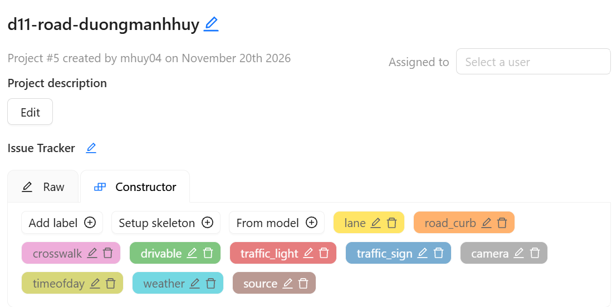
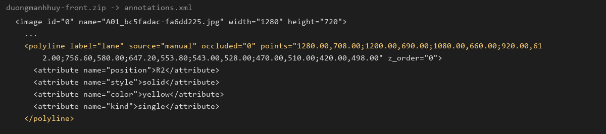

# Báo cáo cá nhân — Ngày 11

Họ tên: Dương Mạnh Huy Mã học viên: 2A202603301
Phiên bản CVAT: 2.81.0
Guideline: Road v1.0 Lần nộp (`revision` trong manifest): 1
Thời điểm export (ngày giờ trên CVAT): 2026-11-21 08:01 (front), 2026-11-21 07:40 (fisheye) — giờ Việt Nam (UTC+7) Số lần nộp lại sau Rework: 0

## 1. Kiểm project

| Mục                                                                                                                                                                                                                                                                                                  | Đúng như guideline Road v1.0? | Ghi chú                                                                                                                                                                                                                                                                                                                                                                                                                                              |
| ---------------------------------------------------------------------------------------------------------------------------------------------------------------------------------------------------------------------------------------------------------------------------------------------------- | ----------------------------- | ---------------------------------------------------------------------------------------------------------------------------------------------------------------------------------------------------------------------------------------------------------------------------------------------------------------------------------------------------------------------------------------------------------------------------------------------------- |
| 6 label, đúng kiểu                                                                                                                                                                                                                                                                                   | Có                            | Project `d11-road-duongmanhhuy` (Project #5) do học viên tự tạo theo xác nhận của coach. Label dán vào tab Raw từ JSON sinh bằng `python -m road_lab.taxonomy` (trùng `configs/road_v1_labels.json`). Kiểu: `lane`, `road_curb` là polyline; `crosswalk`, `drivable` là polygon; `traffic_light`, `traffic_sign` là rectangle. Tab Constructor hiện đủ 6 label (ảnh 1, mục 6).                                                                       |
| Thuộc tính và giá trị                                                                                                                                                                                                                                                                                | Có                            | Cùng nguồn JSON trên: `lane` (position L1/R1/L2/R2/other, style solid/dashed, color white/yellow/other, kind single/double); `drivable` (area_type direct/alternative); `traffic_light` (color red/yellow/green/off/unknown, type vehicle/pedestrian/beacon, facing front/side/back, edge_zone checkbox); `traffic_sign` (group prohibitory/mandatory/warning/information/supplementary/other, facing, edge_zone). Mọi thuộc tính `mutable = false`. |
| 4 tag ảnh                                                                                                                                                                                                                                                                                            | Có                            | `camera`, `timeofday`, `weather` (clear/overcast/rain/fog/other), `source`: mỗi cái là label kiểu Tag với một thuộc tính select tên `value`. Bốn task: `front` (A01–A12), `front-extra` (A13–A16), `fisheye` (B01–B08), `fisheye-extra` (B09–B12), giữ nguyên tên ảnh, sắp xếp Lexicographical.                                                                                                                                                      |
| Cách kết thúc polyline trên bản CVAT này: chọn công cụ Polyline, label `lane` (hoặc `road_curb`), bấm Shape, click các điểm trên tâm vạch từ gần xe (đáy ảnh) ra xa, rồi bấm phím **N** để kết thúc; sau đó mở Details sửa thuộc tính vì polyline mới mang mặc định `L1 / solid / white / single`.   |                               |                                                                                                                                                                                                                                                                                                                                                                                                                                                      |
| Cách đặt tag ảnh trên bản CVAT này: dùng công cụ **Tag** ở thanh bên trái, chọn label (`camera` trước tiên, rồi `timeofday`, `weather`, `source`) và thêm tag cho ảnh; mở **Details** của tag trong bảng Objects để chọn đúng `value` (CVAT tự điền giá trị đầu danh sách, ví dụ `weather = clear`). |                               |                                                                                                                                                                                                                                                                                                                                                                                                                                                      |

## 2. Số lượng đã gán

| Task                            | Ảnh | lane | road_curb | crosswalk | drivable | traffic_light | traffic_sign |
| ------------------------------- | --: | ---: | --------: | --------: | -------: | ------------: | -----------: |
| front                           |  12 |   28 |         8 |         5 |       19 |            28 |           22 |
| front-extra (đã làm 0 / 4)      |   0 |    — |         — |         — |        — |             — |            — |
| fisheye                         |   8 |    6 |         8 |         7 |        4 |             4 |            1 |
| fisheye-extra (đã làm 0 / 4)    |   0 |    — |         — |         — |        — |             — |            — |

Nguồn số liệu: `files[].shapes_by_label` trong `duongmanhhuy-manifest.json` (revision 1, tạo bằng `road_check lint --manifest`).

## 3. Bảng ca khó

| Ảnh | Nhãn | Phân vân giữa | Đã chọn | Lý do |
| --- | ---- | ------------- | ------- | ----- |
| A05 | lane L1/R1 | vẽ L1/R1 theo mép xe đỗ hay không vẽ | không vẽ lane, chỉ `road_curb` phải + `drivable direct` | Đường không có vạch sơn; guideline: không vẽ vạch ảnh không có. Lint báo QC1-02, chờ coach xác nhận miễn |
| A06 | lane R1 | coi hàng cột cầu cạn là R1 hay để trống | để trống R1 | Bên phải làn là hàng cột, không có vệt sơn; lane chỉ gán cho vạch sơn |
| A09 | lane R1 | đoán R1 trong vùng bóng râm hay để trống | để trống R1 | Bên phải làn nằm trong bóng râm, không thấy vệt sơn rõ; chờ coach xác nhận |
| A12 | lane R1 | lấy vạch bên phải của đường ngang làm R1 hay để trống | để trống R1 | Xe đang trong giao lộ; vạch bên phải thuộc đường cắt ngang, không phải làn mình đi |
| A03 | tag `weather` | `clear` hay `overcast` | `overcast` | Trời phủ mây dày lúc chạng vạng, đường khô, không mưa, không sương |
| A06 | traffic_light đi bộ (943,338) | `color = green` hay `unknown` | `green` | Đèn đang hiện hình người đi bộ (pha được đi) — tương ứng pha xanh |
| A07 | traffic_sign mặt sau (536,192), (588,208) | gán hay bỏ; nếu gán thì group nào | gán, `group = other`, `facing = back` | Cao ≥ 8 px nên phải gán; nhìn từ sau không biết chức năng nên chọn `other` |
| A08 | traffic_sign "PASSENGER CARS ONLY" (778,38) | `information` hay `supplementary` | `supplementary` | Là tấm phụ đi kèm biển chỉ hướng Harlem River Dr, có box riêng |
| B02 | traffic_light góc trên (mặt sau) | `color = off` hay `unknown` | `unknown`, `facing = back`, `edge_zone = true` | Nhìn từ sau không thấy mặt đèn nên không biết đèn sáng hay tắt; tâm box ngoài 80 % bán kính |

<!-- Bản nháp lấy theo đúng lựa chọn đang có trong file export; sửa/bỏ dòng nào bạn không đồng ý. -->

## 4. Phiếu QC 1 nhận được

Bạn kiểm lô của tôi: Phạm Minh Quân (phamminhquan) Quyết định nhận được: **Hold** (0 lỗi nặng, 3 lỗi chính / 75 nhãn = 4,0 %, 3 ca chờ lead)

| Mã lỗi | Số lỗi | Đồng ý? | Đã sửa? |
| ------ | -----: | ------- | ------- |
| QC1-04 (A02 L1 đầu xa móc ngược) | 1 | Đồng ý | Chưa — sửa ở buffer |
| QC1-07 (A10 thiếu `alternative`; B06 `direct` tràn qua vạch làn) | 2 | Đồng ý | Chưa — sửa ở buffer |
| Ca mơ hồ A08 L1 / A10 R1 bị che / nhãn ngoài kế hoạch B03, B06 | — | Chờ lead | — |

<!-- Nếu Rework: ghi đã sửa lỗi nào, theo phiếu của ai, lần nộp mới (revision 2) -->

## 5. Kiểm file export

| File                     | Mở lại được? | Số shape ảnh 1 (job / file) | Số shape ảnh 2 (job / file) | Tag camera có trong XML? |
| ------------------------ | ------------ | --------------------------- | --------------------------- | ------------------------ |
| duongmanhhuy-front.zip   | Có (`road_check lint` đọc đủ 12 ảnh) | A01: 9 / 9 | A02: 5 / 5 | Có, 12/12 ảnh có `<tag label="camera">` |
| duongmanhhuy-fisheye.zip | Có (`road_check lint` đọc đủ 8 ảnh)  | B01: 3 / 3 | B02: 6 / 6 | Có, 8/8 ảnh có `<tag label="camera">` |

<!-- Số "job" (__) đọc trong bảng Objects của job trên CVAT 2.81 (đếm shape, không đếm tag); số "file" đếm trong annotations.xml. Hai số phải bằng nhau. -->

Mở lại file: cả hai zip chỉ chứa `annotations.xml` (CVAT for images 1.1, không kèm ảnh), manifest ghi `contains_images: false`; lint không còn lỗi nặng ngoài QC1-02 ở A05, A06, A09, A12 (xem mục 3).

## 6. Ảnh chụp màn hình

1. Tab Labels của project.
2. Một ảnh camera trước đã gán đủ (làn, vùng lái, đèn/biển): A08 — L1/R1/R2, drivable direct + alternative, crosswalk, road_curb, 9 đèn, 6 biển. Ảnh có pixel BDD100K nên chỉ nhúng trong bản nộp kênh coach (`screenshots/02-front-annotated.jpg`), không đưa vào repo.
3. Một ảnh fisheye đã gán, phóng to đoạn polyline cong: B03 (fisheye_rear) — R1, R2 trắng đứt theo cung. Ảnh có pixel WoodScape nên chỉ nhúng trong bản nộp kênh coach (`screenshots/03-fisheye-zoom.jpg`), không đưa vào repo.
4. Một đoạn XML có <polyline label="lane"></polyline>.
   

## 7. Tự đánh giá

Lỗi bạn mắc nhiều nhất hôm nay (theo mã QC1-xx), và cách tránh ở Ngày 20: **QC1-07 (vùng lái)** — 2/3 lỗi Quân ghi: A10 bỏ sót `alternative` cho làn cùng chiều bên phải, B06 `direct` tràn qua vạch làn sang làn khác và đường ray. Nguyên nhân: vẽ drivable theo mép mặt đường thay vì theo vạch làn, và quên kiểm làn cùng chiều bên cạnh. Cách tránh ở Ngày 20: vẽ lane trước, rồi bám mép `direct` đúng theo L1/R1 (bật snap vào điểm của polyline), sau mỗi ảnh tự hỏi "bên phải R1 còn làn cùng chiều không?" trước khi Ctrl+S. Lỗi thứ hai là **QC1-04** (A02 đầu xa L1 bị móc ngược): phóng to đoạn cuối polyline trước khi bấm N.  
Nhãn của bạn đi vào model ở đâu? Chọn một lỗi đã sửa và nói nó làm model học sai thế nào: Polygon `drivable` là nhãn cho bài toán phân đoạn vùng lái (drivable area segmentation), đầu ra dùng cho lập kế hoạch đường đi. Lỗi B06 (`direct` tràn qua vạch đứt sang làn khác và đường ray) dạy model rằng làn bên cạnh và đường ray cũng là "làn xe đang đi": model sẽ dự đoán vùng `direct` quá rộng, planner có thể cho phép xe lấn làn hoặc chọn quỹ đạo cắt qua đường ray. Polyline lane (A02) là nhãn cho bài toán phát hiện làn kiểu row-anchor: đoạn móc ngược làm sai giá trị x ở các hàng xa, model học một làn cong giả, ảnh hưởng hệ thống giữ làn (LKA) khi nhìn xa.  
<!-- Bản nháp Claude soạn dựa trên phiếu QC 1 nhận được; sửa lại bằng lời của bạn. Sau buffer, đổi "lỗi đã sửa" cho khớp lỗi bạn thực sự sửa. -->

## 8. (Tùy chọn, buffer) Từ polyline đến đích row-anchor

| y               | 720 | 680 | 640 | 600 | 560 |
| --------------- | --: | --: | --: | --: | --: |
| x của chúng tôi |     |     |     |     |     |
| x của bạn kia   |     |     |     |     |     |

Trả lời 3 câu:

1. Năm số x đó chính là đích mà một model row-anchor học cho vạch này. Nếu bạn dừng polyline sớm 40 px, hàng nào đổi thành "không có làn"?
2. So với bạn được kiểm (cùng ảnh): ở hàng 720 và hàng 560, hai bạn lệch nhau bao nhiêu pixel? Lệch ở hàng nào ảnh hưởng LKA nhiều hơn (slide 25)?
3. Nếu polyline vẽ từ xa về gần (ngược quy tắc 2), cách tính trên có đổi không? Script nào sẽ gặp khó?
